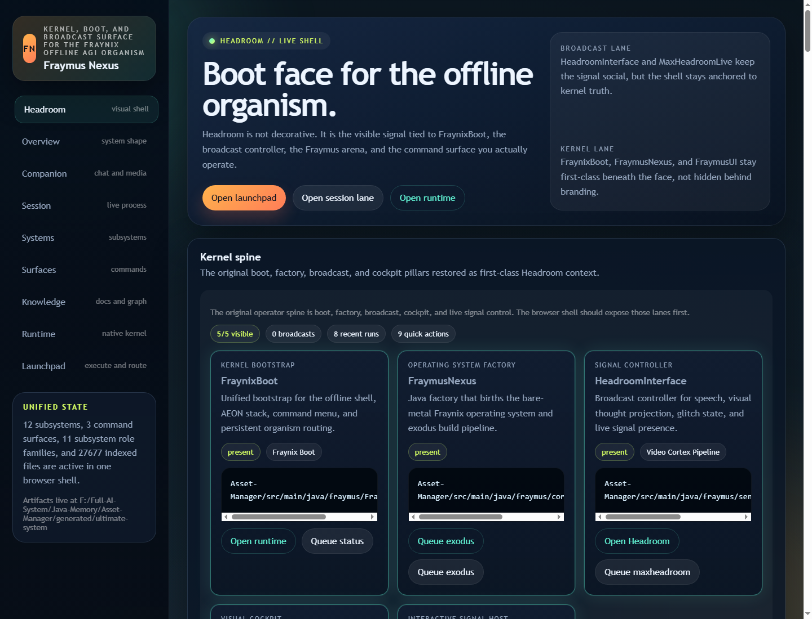
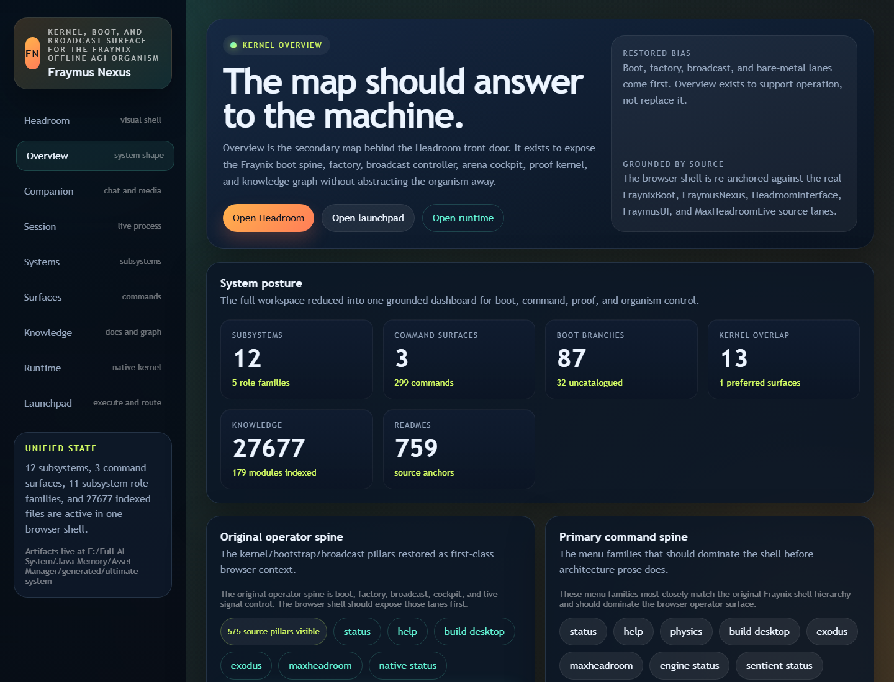
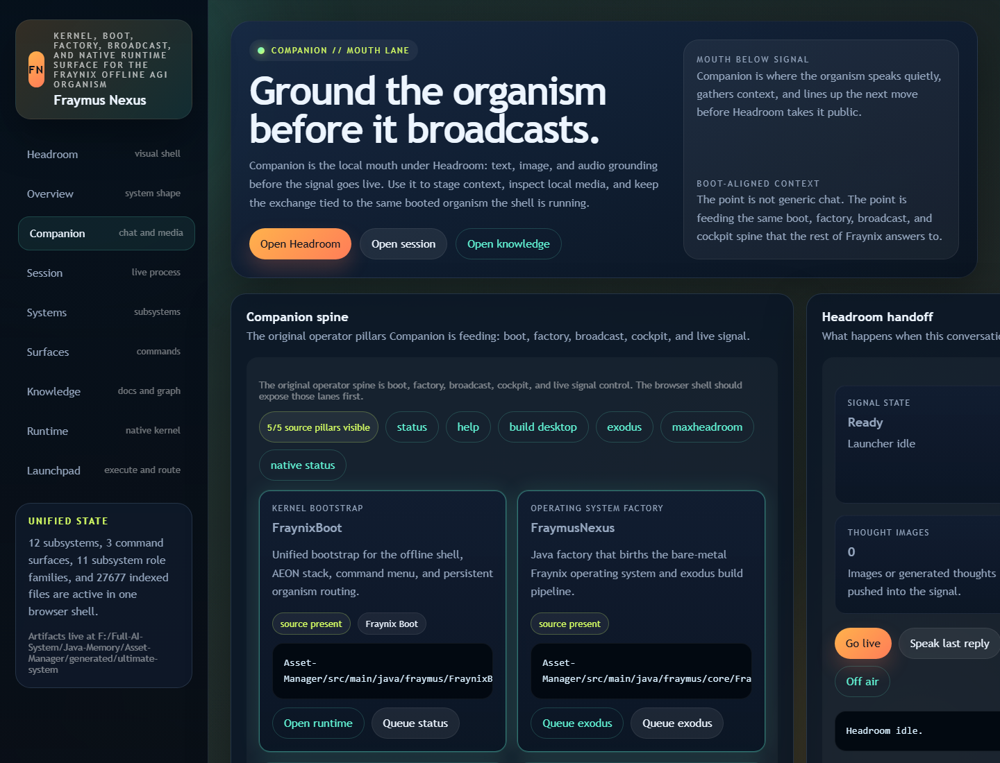
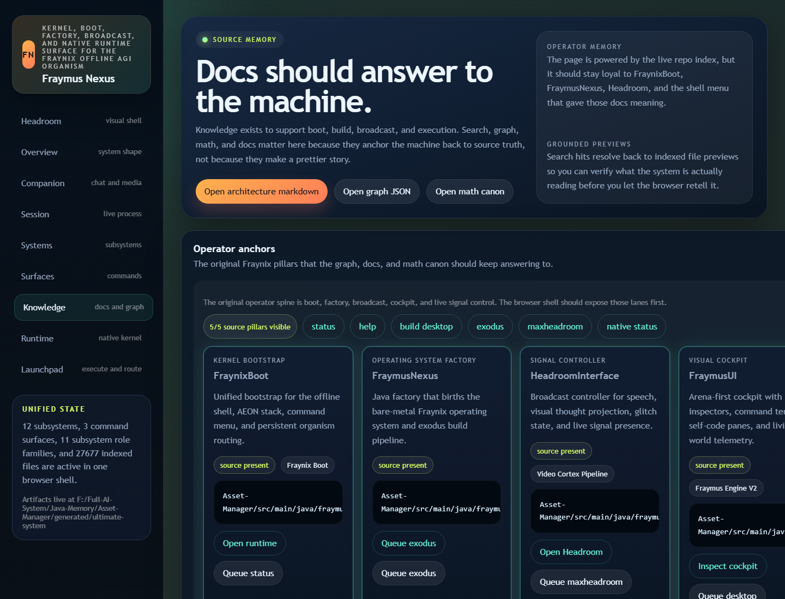
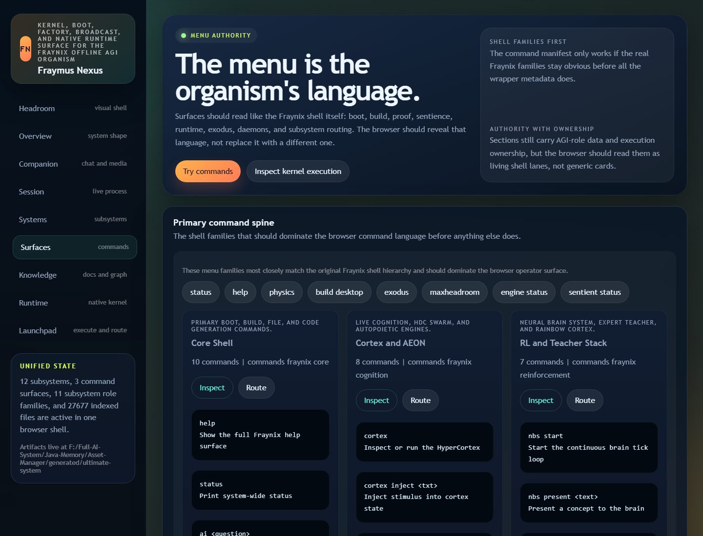
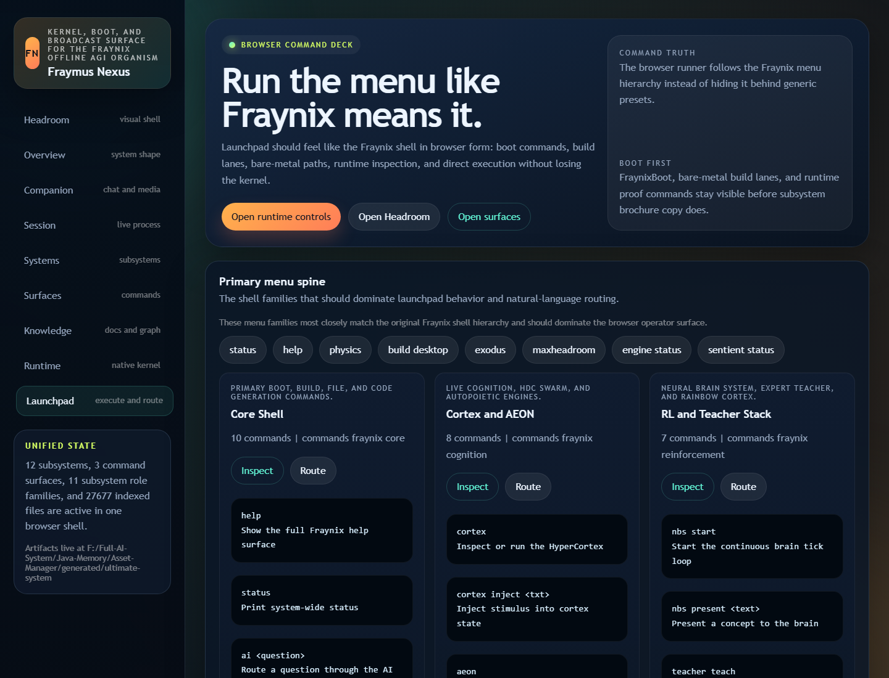
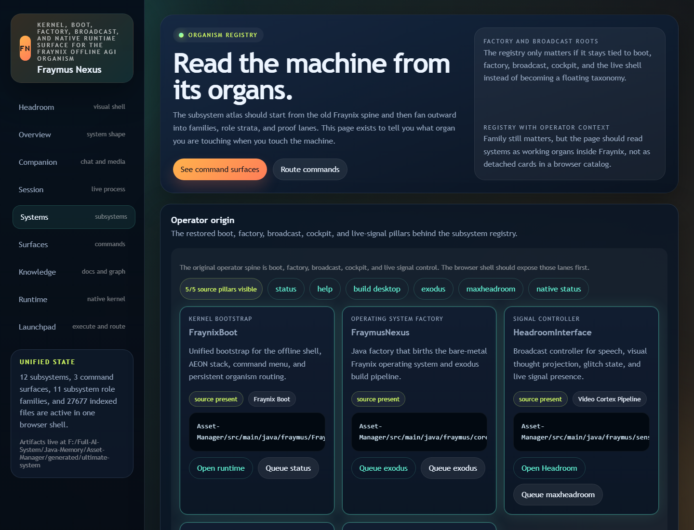
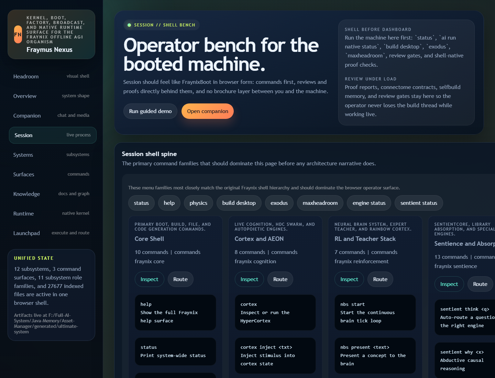
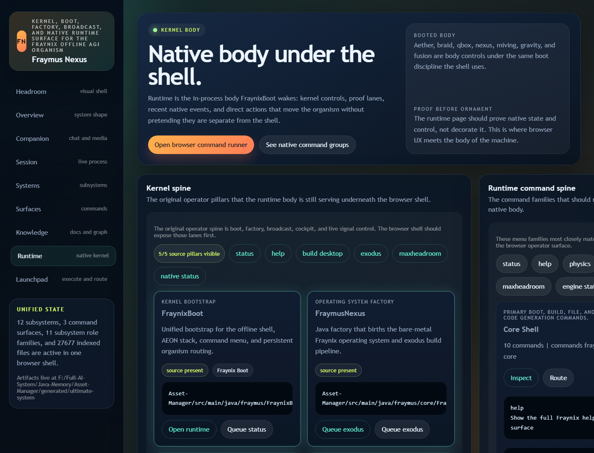
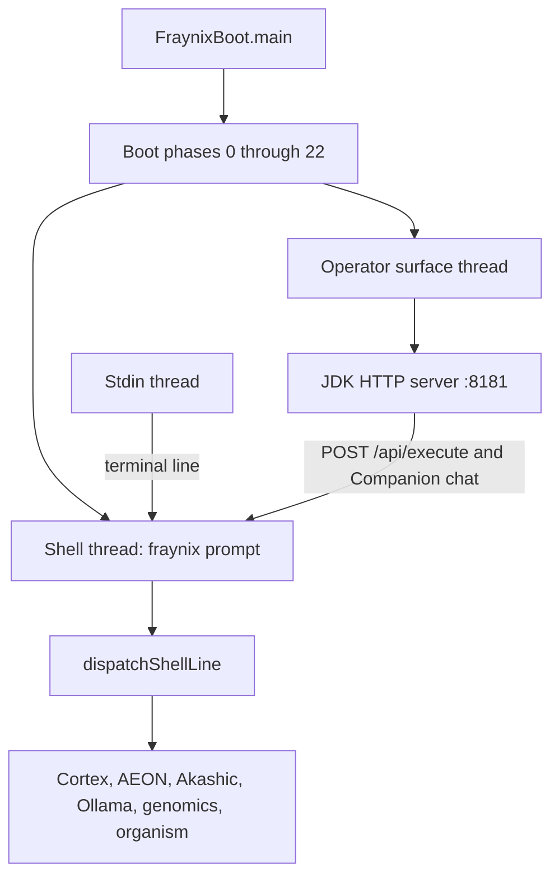

# Fraynix

**Fraynix, by Vaughn Scott.** A local Java organism with a full command shell and a browser operator surface on the same process.

The terminal is still the boot. The browser is the same shell, with pages for chat, documents, commands, and execution. One Gradle task starts both.

```powershell
cd Asset-Manager
.\gradlew.bat --offline --no-daemon --console=plain runFraynixBoot
```

When the boot finishes, the `fraynix>` prompt is ready. A second thread then opens the operator surface, prints its URL, and opens the browser. The default address is [http://localhost:8181/](http://localhost:8181/).

Browser chat and Launchpad commands are queued onto that same `fraynix>` dispatcher. The terminal prints each one as `[browser] ...`. Type `exit` in the terminal to save state and shut the process down. The browser cannot shut the organism down.

## What this is

FraynixBoot is the unified bootstrap. It brings up the local engines, mounts a virtual filesystem, connects the optional Ollama voice, and then sits in an interactive shell. The command set is the product: status, orchestration, code and artifact production, identity, genomics, cortex, AEON modules, and the rest of the menu in `help`.

The browser is `fraymus.ultimate.UltimateUiServer`. It is still pure Java. It uses the JDK `HttpServer`, serves the pages under `src/main/resources/ultimate-ui/`, and, when it is started from the boot, sends operator text into `FraynixBoot.executeShellLine`. Standalone `runUltimateUi` still works. That task serves the same pages without the live boot, and its runner is the separate `UltimateSystem` router.

This repository is the Asset-Manager application: the boot, the shell, the browser, the offline kernel sources, and the operator docs. Model weights are not in the repo. They stay in your local Ollama store.

## Screenshots

These are the operator pages served by the Java UI.

### Headroom

The front door. Headroom is the visible shell: boot, factory, broadcast, and the command buttons that call back into Fraynix.



### Overview

The map behind the front door: boot spine, command families, subsystems, and the indexed source set.



### Companion

The chat page. Text typed here is executed as a shell line on the booted organism. A normal sentence falls through to the `ai` lane. A command such as `menu` or `status` runs as that command.



### Knowledge

Search, graph, and document view over the repo. This is the vault page: architecture notes, math canon, and source anchors, closer to a working notebook than to a marketing site.



### Surfaces

The command catalog, grouped the way the shell menu is grouped. Cards deep-link into Launchpad.



### Launchpad

Type a Fraynix command and run it. On a booted organism the response mode is `fraynix-boot`, and the same output is echoed in the terminal.



### Systems, session, and runtime

Systems is the subsystem index. Session is the live process view. Runtime is the native kernel and proof surface.







## Run it

Requirements:

- JDK 21 or newer
- The Gradle wrapper in this folder (`gradlew.bat` on Windows, `./gradlew` on macOS and Linux)
- The modules `settings.gradle` includes: `factory-runtime`, `factory-kernel`, `factory-models`, `sandbox`, and `brain_architecture`
- Optional: [Ollama](https://ollama.com/) listening on `http://127.0.0.1:11434` for `ai`, Companion answers, and the Fraymus voice

The wrapper is offline-friendly once the Gradle cache and the declared libraries are already on the machine.

```powershell
.\gradlew.bat --offline --no-daemon --console=plain compileJava
.\gradlew.bat --offline --no-daemon --console=plain runFraynixBoot
```

Flags:

| Flag | Effect |
| --- | --- |
| `--no-ui` | Boot the terminal only. |
| `--no-browser` | Serve the pages, and do not open a window. |
| `--ui-port=8181` | Bind this port first. If it is taken, the server tries the next ports. |
| `--model=name` | Chat model tag passed through the existing boot argument. |
| `--generate` | Generate the bare-metal image path and skip the normal wait. |

`FRAYNIX_UI_PORT` does the same job as `--ui-port` when the flag is absent. `java -Dfraynix.uiPort=8181` and `-Dfraynix.ui.disable=true` are the system-property forms.

The UI-only server, without the organism boot, is still available:

```powershell
.\gradlew.bat --offline --no-daemon --console=plain runUltimateUi -PuiPort=8181
```

Use that when you want the pages and the UltimateSystem router. Use `runFraynixBoot` when you want the pages attached to the live shell.

Leave the boot with `exit` or `quit` from the terminal. The shutdown path stops the browser server, the physics engines, and the cortex, then writes AkashicRecord. `exit` over HTTP is refused on purpose.

## How the browser sits on the boot



The shell thread is the only thread that runs a command. The terminal and the browser both submit a job. Terminal jobs print straight to the console. Browser jobs capture stdout and stderr, return that text as JSON, and also echo it to the console so the operator can see what the page did.

That is why a long `ai` question from Companion holds the prompt until it finishes. There is one organism, and one command at a time, the same rule the terminal already had.

Nested REPLs such as `tachyon shell`, `aubo shell`, and `singularity shell` still read the terminal keyboard. They are not a second web session.

Two honest limits of the current wiring:

- Overview and runtime cards are rendered by `UltimateSystem`. They describe that router’s snapshot. A card can say a lane is offline while the booted gravity engine or cortex is actually up. The command you run is still the boot command.
- The first browser connection waits while the UI thread builds its knowledge index. The `fraynix>` prompt is already usable during that wait.

## The pages

| Page | Path | Use it for |
| --- | --- | --- |
| Headroom | `/` | The visual shell and the live signal surface. |
| Overview | `/overview` | Boot spine, command families, subsystem map. |
| Companion | `/companion` | Chat and local media context. On a boot, the reply comes from the shell. |
| Session | `/session` | The current process and self-build session. |
| Systems | `/systems` | Subsystem index and focus actions. |
| Surfaces | `/surfaces` | The command catalog, grouped by shell family. |
| Knowledge | `/knowledge` | Docs, search, graph, and the math canon. |
| Runtime | `/runtime` | Native kernel and proof controls. |
| Launchpad | `/launchpad` | Run one command and read the output. |

Useful endpoints:

| Endpoint | Role |
| --- | --- |
| `POST /api/execute` | Body `{"command":"menu"}`. On the boot, `mode` is `fraynix-boot`. |
| `POST /api/companion/chat` | Body `{"prompt":"..."}`. The prompt is a shell line. |
| `GET /api/knowledge` | Vault index. |
| `GET /api/search?q=` | Document search. |
| `GET /api/doc?path=` | One indexed document. |
| `GET /api/surfaces` | Command families. |

## Boot, in the order the console prints it

The banner is Fraynix v17. The phases you will actually see:

1. Hardware profile. CPU pools sized to the machine, plus a CUDA note when a GPU is present.
2. Phi constants and the reality substrate.
3. FrayFS, the in-memory filesystem, and the local biometric avatar vault.
4. Gravity engine. Hebbian physics.
5. Fusion reactor. Thought collision.
6. Spatial registry.
7. AI voice. Ollama at `127.0.0.1:11434` when it is running. The boot continues if it is not.
8. Knowledge. AkashicRecord and the library absorber.
9. Code and image builders for the bare-metal path.
10. Cortex, AEON Prime, Absolute, Singularity, AUBO, Tachyon, Kronos, Omniscience, Demiurge, Apotheosis, Omega, Babel.
11. The unified brain orchestrator, active inference, world model, embodied lane, and the energy-aware inference path.
12. The shell, then the operator surface.

`status` prints the live board: AI link, Akashic, avatar vault, cortex size, and the AEON modules. `menu` is the short form. `help` is the full list.

## Command map

Start here:

```text
menu
status
help
system map
system <goal>
```

### Orchestration

| Command | What it does |
| --- | --- |
| `system <goal>` | Hand a goal to the orchestrator. |
| `system map` | Show how goals route across modules. |
| `system status` | Unified status and module health. |
| `system execute <goal>` | Plan, simulate, then run under the guard. |
| `system execute --plan <goal>` | Plan only. |
| `system execute --simulate <goal>` | Plan and simulation only. |
| `system improve <goal>` | Self-improvement lane. `system improve help` lists the boundary. |
| `adapt status` | Trend and drift profile. |
| `adapt refresh` | Recompute it from runtime and the local corpus. |
| `adapt recommend <goal>` | Suggest a produce lane. |
| `produce <type> <goal>` | Make an artifact. Types include `code`, `report`, `image`, `proof`, `patent`, `all`, `omni`, `full`, `auto`. |
| `ai <question>` | Ask the grounded voice. Requires Ollama. A plain sentence with no command word also lands here. |
| `openmodel status` | Open-model sources and skills already ingested. |
| `openmodel refresh` | Re-read those sources. |

### Identity, organism, body

| Command | What it does |
| --- | --- |
| `avatar help` | Local biometric vault commands. |
| `avatar status` | Vault summary. |
| `organism start` | FlyGM organism lane. |
| `organism status` | Organism plus continuity bridge. |
| `organism cycle` | Run lifecycle cycles. |
| `emotion status` | Seven-layer emotion engine. `feel` is the alias. |
| `ouroboros-server status` | Loopback adaptive service. |

### Knowledge and filesystem

| Command | What it does |
| --- | --- |
| `fs` | List FrayFS. |
| `fs read <path>` | Read one virtual file. |
| `fs write <path> <text>` | Write one virtual file. |
| `think <text>` | Store a thought under `memories/`. |
| `absorb <package>` | Absorb a package into the library and the cortex. |
| `phi` | Print phi, phi squared, and 1/phi. `phi 5` prints phi to that power. |

### Cognition modules

Each of these prints status with no arguments. Most accept `inject`, `learn`, `shell`, or a count of cycles. `help` is authoritative when a submodule has grown past this list.

| Command | Module |
| --- | --- |
| `cortex` | HyperCortex. `cortex 10` runs cycles. `cortex inject <text>` stimulates it. |
| `aeon` | AEON Prime. Shadow simulation and axiom. |
| `absolute` | Sovereign swarm. `absolute ignite`, `learn`, `recall`. |
| `singularity` or `sing` | 8192-d holographic lane. |
| `aubo` | Ledger. `mint`, `track`, `kill`, `ledger`. |
| `tachyon` | Bind, query, and the numeric `ftl` seed. |
| `kronos` | Relationship and sequence memory. |
| `omniscience` or `omni` | Fractal blend and dream state. |
| `demiurge` | Physics particles and collision. `demiurge collide <A> <B>`. |
| `apotheosis` | Desire, transcribe, restore. Genomics text can route here too. |
| `omega` | Living language lane. |
| `babel` | Polyglot transmutation. `babel target <lang>`. |
| `primal` | Primal lane. |
| `willow` | Willow proofs. `willow hadamard <n>`. |
| `openclaw` or `claw` | Raster and claw lane. |
| `hrm` | Neuromorphic cortex lane. |

### Media, genomics, and the bare-metal image

| Command | What it does |
| --- | --- |
| `media`, `voice`, `dream` | Media output lane through the unified orchestrator. |
| `genomics status` | Carbon DNA worker status. |
| `genomics inventory` | FASTA inventory and hashes. |
| `genomics analyze <files>` | Local analysis. Add `--compare-shuffled` for a composition-matched check. |
| `genomics generate <file> --bases 120` | Continue a sequence. This does not fine-tune Carbon weights. |
| `specialist list` | Local specialist workers. |
| `specialist profile` | One specialist profile. |
| `exodus` | Exodus image lane. `exodus verify`, `exodus launch`. |
| `desktop` or `construct` | Desktop construction lane. |
| `generate` | Bare-metal builders into `fraynix_src/`. |
| `code <description>` | Generate source into FrayFS. |

Genomics and specialist results are written under `reports/` and indexed into AkashicRecord when that store is mounted. Sequence function and plasmid viability are not proved by a likelihood score. Treat those numbers as local evidence and validate them separately. See `docs/CARBON_GENOMICS_INTEGRATION_2026-10-25.md` and `docs/SPECIALISTS_AND_DIGITAL_GENOME_2026-10-25.md`.

### Distributed and signal lanes

`aether`, `braid`, `learn`, `pulse`, `retro`, `emf`, and `agora` or `stego` are the bridge commands. `help` prints the current subcommands. `physics` prints gravity, fusion, and the spatial registry together. `holographic` is the holographic memory command.

## Local models

The voice box talks to Ollama. The boot log names the model it actually reached. A verified local catalog can live at `%USERPROFILE%\.fraymus\models\local-model-catalog.json`. Weights are installed on the machine, not cloned with this repo.

```powershell
powershell -NoProfile -ExecutionPolicy Bypass -File .\scripts\Start-LocalModelStores.ps1
powershell -NoProfile -ExecutionPolicy Bypass -File .\scripts\Sync-LocalModelCatalog.ps1
.\gradlew.bat --offline --no-daemon :verifyLocalModels
```

Details: `docs/LOCAL_MODEL_INTEGRATION.md` and `docs/OLLAMA_JSON_STARTUP_FIX_2026-10-25.md`.

Carbon, the DNA specialist, loads only when a genomics inference command asks for it. Runtime configuration is `%USERPROFILE%\.fraymus\models\carbon-runtime.json` or `FRAYNIX_CARBON_CONFIG`. The default verified path is CPU inference.

## Layout

```text
Asset-Manager/
  gradlew.bat                 Boot script
  build.gradle                Tasks, including runFraynixBoot and runUltimateUi
  src/main/java/fraymus/
    FraynixBoot.java          Boot, shell, and browser bridge
    ultimate/                 Browser server and the UltimateSystem router
    os/                       FrayFS and boot image pieces
    neural/                   Cortex and AEON modules
    brain/                    Unified orchestrator
    genomics/                 Carbon bridge
    identity/                 Local avatar vault
    knowledge/                AkashicRecord
  src/main/resources/ultimate-ui/
    index, companion, knowledge, surfaces, launchpad, ...
    assets/app.css            The dark operator theme
    assets/app.js             Page behavior and /api calls
  factory-runtime/            Gradle module on the boot classpath
  factory-kernel/             Gradle module on the boot classpath
  factory-models/             Included model module
  sandbox/                    Included sandbox module
  brain_architecture/         Offline kernel sources. Local memory under .brain_memory and .northstar-kernel stays on the machine
  docs/                       Operator notes and the screenshots in this README
  scripts/                    Local model, avatar, exodus, and genomics helpers
```

Other Gradle entry points exist for narrower demos (`runLivingMind`, `runGenesisEngine`, `runNanoSwarm`, and others). `runFraynixBoot` is the one that owns the full menu.

## Persistence

AkashicRecord is the long memory. A normal `exit` asks it to save. The large local block file `.akashic/blocks.dat` is intentionally not in this repository. A fresh clone starts with an empty record and fills it from the running organism. Genesis vault files that the boot expects are included where they are part of the source tree. Your private biometric captures and model weights stay on your machine.

## Build and test

```powershell
.\gradlew.bat --offline --no-daemon compileJava
```

Focused checks, each in its own output directory:

```powershell
python .\scripts\verify-avatar-json.py --output "$env:TEMP\fraynix-avatar-test"
python .\scripts\verify-ollama-json.py --output "$env:TEMP\fraynix-ollama-test"
python .\scripts\verify-exodus.py --output "$env:TEMP\fraynix-exodus-test"
.\scripts\prove-exodus-qemu.ps1
```

Avatar checks use stand-in capture scripts. Exodus checks boot a generated image in QEMU when QEMU is installed. Self-improvement has its own boundary, written in `docs/SELF_IMPROVEMENT_SHELL.md`.

## Further reading

| Note | Subject |
| --- | --- |
| `docs/SELF_IMPROVEMENT_SHELL.md` | `system improve`, preview, and promotion. |
| `docs/LOCAL_MODEL_INTEGRATION.md` | Local model catalog and endpoints. |
| `docs/CARBON_GENOMICS_INTEGRATION_2026-10-25.md` | Carbon worker and FASTA evidence. |
| `docs/SPECIALISTS_AND_DIGITAL_GENOME_2026-10-25.md` | Specialist workers and shared memory. |
| `docs/AKASHIC_PERSISTENCE_DESIGN.md` | How the record is stored. |
| `docs/FRAYMUS_MATHEMATICAL_FOUNDATIONS.md` | The math notes the knowledge page links. |
| `docs/DEPLOYMENT_RUNBOOK_FRAYMUS_FRAYNIX_2026-05-21.md` | UI-only and full-runtime deploy lanes. |
| `docs/SINGULARITY_PROTOCOL.md` | Singularity lane notes. |
| `COMMAND_TERMINAL_GUIDE.md` | Earlier command commentary. `help` in a live shell wins if they differ. |

## What a clone does not include

- Ollama weights and the Carbon weight files
- `.akashic/blocks.dat`, the multi-gigabyte local memory store
- Private key material. `*.pem` is gitignored. API keys and OAuth client secrets are not part of the published tree; set them in the environment on your machine
- Local brain runtime state in `brain_architecture/.brain_memory` and `brain_architecture/.northstar-kernel`
- Third-party textbooks that had been dropped in `attached_assets` for local reading
- Build output, `.class` files, and `node_modules`

## License

See the existing project notices beside the sources. Nothing in this README grants rights to third-party models, papers, or books.
